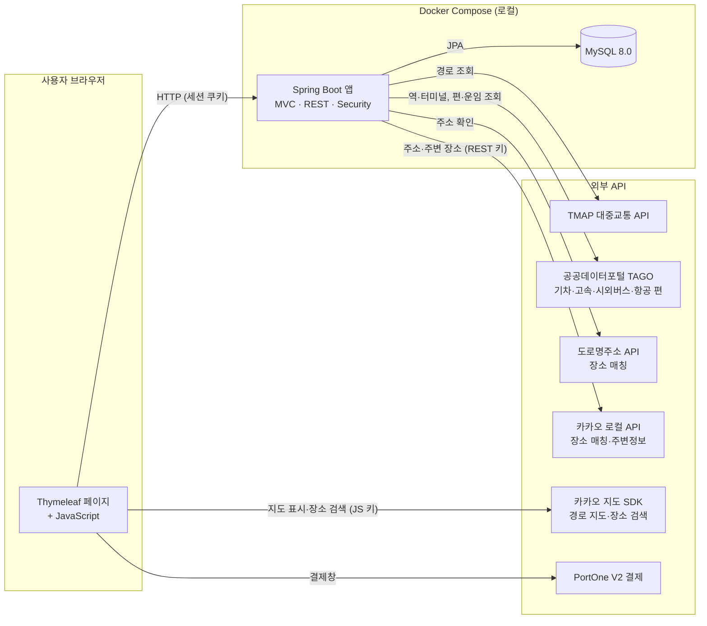
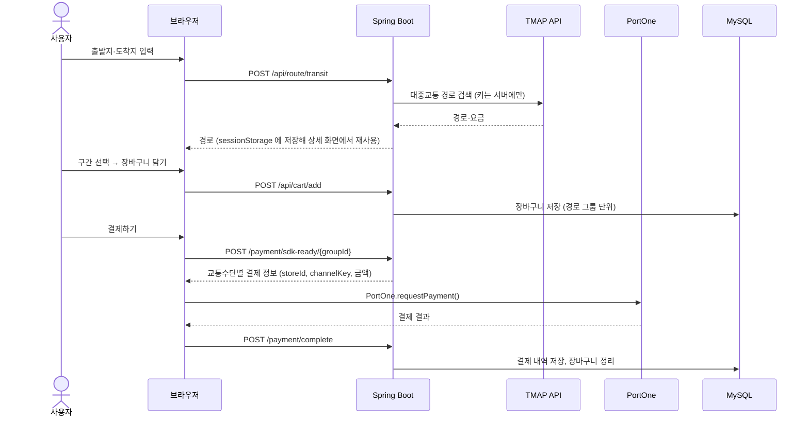

# MobilLax

**흩어진 대중교통 경로 검색·예매·결제를 하나의 웹에서 처리하는 통합 모빌리티 서비스**


> 2025-1학기 졸업 캡스톤디자인 3인 팀 프로젝트를
> 팀 대표였던 본인이 **개인 프로젝트로 이어받아 개선**하고 있는 저장소입니다. → [버전 로드맵](#-버전-로드맵)
> v1.x(원본을 로컬에서 실제 데이터로 동작시키기)를 마쳤습니다. 원본 대비 문제점·개선점·바뀐 점: [docs/V1_SUMMARY.md](docs/V1_SUMMARY.md)

---

## 📌 목차

1. [프로젝트 개요](#-프로젝트-개요)
2. [주요 기능](#-주요-기능)
3. [아키텍처](#-아키텍처)
4. [기술 스택과 선정 이유](#-기술-스택과-선정-이유)
5. [로컬 실행 가이드](#-로컬-실행-가이드)
6. [프로젝트 구조](#-프로젝트-구조)
7. [버전 로드맵](#-버전-로드맵)
8. [AI 도구 활용](#-ai-도구-활용)
9. [팀 프로젝트 이력](#-팀-프로젝트-이력)
10. [회고](#-회고)

---

## 🧭 프로젝트 개요

### 해결하려는 문제

시내·시외버스, 지하철, 철도 같은 대중교통 수단은 **교통수단마다 다른 앱과 서비스로 나뉘어** 있습니다.
여러 수단을 갈아타는 장거리 이동이면 사용자는 경로 검색, 요금 확인, 예매, 결제를 앱마다 따로 반복해야 합니다.

### 접근 방법

- **경로:** 출발지와 도착지를 한 번 입력하면 TMAP 대중교통 API가 여러 수단을 엮은 경로와 구간별 요금을 돌려줍니다.
- **편 선택:** 장거리 구간(**기차·고속버스·시외버스·항공**)마다 공공데이터포털(TAGO)에서 그날의 실제 편과 운임을 조회해 고릅니다. 앞 편을 바꿔 다음 편을 탈 수 없게 되면 이어 탈 수 있는 첫 편으로 다시 고르고 알려 줍니다. 금액 줄에서 시내 교통비(현장 결제 예상)를 함께 보거나 숨길 수 있습니다.
- **장바구니:** 고른 편을 그 운임으로 장바구니에 담습니다. 시내버스·지하철·택시, 그리고 예매 정보가 없는 공항 리무진·일부 심야 시외버스는 현장에서 내므로 **예상 운임과 함께 안내만** 합니다.
- **결제:** 장바구니에서 결제할 묶음을 골라 결제합니다. 결제창은 교통수단마다 한 번씩 열리며, 몇 번 열리는지와 합계를 결제 전에 보여 줍니다. 결제할 수 없는 묶음(출발한 편 등)은 이유와 함께 미리 막습니다.
- **마이페이지:** 예매 내역(결제 완료·실패, 내역에서 삭제), 이번 달 결제 합계, 최근 경로, 프로필 수정, 비밀번호 변경을 제공합니다. 내역에서 삭제한 결제도 기록은 법정 보존 기간 동안 보관합니다.
- **로그인 없이 둘러보기:** 경로 검색·상세·편 조회·요금비교·주변정보는 로그인 없이 씁니다. 예매할 때만 로그인하고, 로그인하면 보던 경로 화면으로 돌아옵니다. 외부 API 한도(TMAP 하루 10건)를 지키려고 호출 횟수를 제한합니다.
- **어느 화면에서든 한 번에:** 상단 메뉴에서 경로 검색·장바구니(담긴 묶음 수)·예매 내역·마이페이지로 바로 가고, 로그인 세션 남은 시간을 보여 주며 연장할 수 있습니다.

---

## ✨ 주요 기능

| 영역        | 기능                                                                                                                                 | 상태      |
| ----------- | ------------------------------------------------------------------------------------------------------------------------------------ | --------- |
| 회원        | 회원가입, 로그인·로그아웃 (세션 30분, BCrypt 해싱, 비밀번호를 여러 번 틀리면 15분 잠금), 세션 남은 시간 표시·연장                    | ✅        |
| 경로 검색   | 출발지·도착지 장소 검색, 대중교통 다중 경로 조회(로그인 없이도, 호출 횟수 제한), 출발 일시 지정 (오늘부터 14일, 다른 날은 조회 전용) | ✅        |
| 경로 상세   | 구간별 교통수단·소요 시간·요금 표시, 지도 위 경로 시각화                                                                             | ✅        |
| 편 선택     | 장거리 구간마다 공공데이터(TAGO) 실제 편·운임 조회와 선택 (당일 예매, 14일 조회)                                                     | ✅        |
| 장바구니    | 장거리 구간(기차·고속·시외버스·항공)을 고른 편의 운임으로 담기, 경로 묶음 단위 조회·삭제, 결제할 묶음 선택                           | ✅        |
| 결제        | 경로 상세에서 바로 결제, 장바구니에서 고른 묶음 결제 (교통수단별 분할, PortOne V2 테스트 결제)                                       | ✅        |
| 요금비교    | 마지막 검색의 경로를 요금·시간·환승 순으로 비교, 가장 좋은 경로와의 차이 표시, 고른 경로의 상세로 이동 (TMAP 추가 호출 없음)         | ✅        |
| 주변정보    | 출발지·도착지 1km 안의 음식점·카페·편의점·지하철역·숙박·관광명소·주차장 (카카오 로컬, 서버 대신 호출, 저장하지 않음)                 | ✅        |
| 마이페이지  | 프로필 수정, 비밀번호 변경, 예매 내역, 이번 달 결제 합계, 최근 이용 경로, 회원 탈퇴 (알림 설정은 준비 중)                            | ✅        |
| 관리자      | 지정 이메일 관리자, OTP(TOTP) 2단계 인증·복구 코드, 계정 검색·정지·로그인 잠금 해제(OTP 재확인), 숨긴 결제 보기, 감사 로그           | ✅ v2.11  |
| 실시간 정보 | 경로 세부 내역의 실시간 반영                                                                                                         | ⏳ 미구현 |

> 실제 예매·발권은 운송사와 제휴해야 하므로, 이 프로젝트는 **발권이 가능하다고 가정**하고 PortOne 테스트 결제까지만 합니다. **실제 서비스에서는 운송사(코레일·SR·버스 통합예매·항공사) 예매 시스템과 연동**해 실시간 좌석·미래 날짜 예매와 발권을 처리합니다. 예매 대상과 날짜 규칙은 [docs/PUBLIC_DATA_API.md](docs/PUBLIC_DATA_API.md)에 있습니다.

---

## 🏗 아키텍처

### 시스템 구성도



- 모든 키는 `.env` 한 곳에서 관리합니다.
- 경로·편·장소 매칭·결제 확인 같은 API 호출은 모두 서버가 합니다. TMAP·카카오 REST·공공데이터·PortOne 비밀키는 **서버 전용**입니다.
- 브라우저로 가는 키는 **카카오 JavaScript 키 하나**뿐입니다. 등록한 도메인에서만 동작하도록 설계된 키이고, 서버가 템플릿(`FrontendKeyAdvice`)으로 내려줍니다. → [보안 규칙 S9](docs/SECURITY_RULES.md#s9-브라우저로-가는-키-v23)

### 예매·결제 흐름



### 데이터 모델

| 테이블             | 내용                                                               |
| ------------------ | ------------------------------------------------------------------ |
| `users`            | 회원 (이메일, 이름, BCrypt 비밀번호)                               |
| `cart_item_entity` | 장바구니 구간 (경로 그룹 ID, 교통수단, 출발·도착, 요금, 삭제 여부) |
| `payments`         | 결제 내역 (결제 ID, 그룹 ID, 교통수단, 금액, 상태)                 |

---

## 🛠 기술 스택과 선정 이유

| 분류          | 기술                                | 선정 이유                                                                                                                                                          |
| ------------- | ----------------------------------- | ------------------------------------------------------------------------------------------------------------------------------------------------------------------ |
| 언어          | **Java 21**                         | 현재 LTS 버전. 장기 지원을 받으면서 record·패턴 매칭 같은 최신 문법을 쓸 수 있음                                                                                   |
| 프레임워크    | **Spring Boot 3.2**                 | 회원·결제·외부 API 연동을 한 애플리케이션에서 다루기에 생태계(Security, JPA, WebClient)가 가장 넓고, 팀원 모두 익숙했음                                            |
| 인증          | **Spring Security** (세션 + BCrypt) | 서버 렌더링 구조에서는 JWT보다 세션 방식이 단순함. 폼 로그인, 비밀번호 해싱, 접근 제어를 직접 구현하지 않고 검증된 구현을 씀                                       |
| 뷰            | **Thymeleaf**                       | 별도 프론트엔드 서버 없이 하나의 앱으로 배포할 수 있음. Spring Security와 통합되어 로그인 상태에 따른 화면 분기가 쉬움                                             |
| 데이터        | **Spring Data JPA + MySQL 8.0**     | 회원·장바구니·결제처럼 관계와 정합성이 중요한 데이터라 RDBMS를 씀. JPA로 반복 SQL을 줄임                                                                           |
| 외부 API 호출 | **WebClient / RestTemplate**        | 공공데이터 API를 비동기(WebClient)로 호출. XML 응답은 Jackson XML로 매핑                                                                                           |
| 경로          | **TMAP 대중교통 API**               | 여러 교통수단을 엮은 경로와 **구간별 요금**을 함께 주는 공개 API여서 "통합 예매"라는 목표에 직접 맞음                                                              |
| 지도          | **카카오 지도 SDK**                 | 경로 시각화와 홈 화면 장소 검색(자동완성). 브라우저용 JavaScript 키가 도메인 제한을 지원해서, 도메인 제한이 없는 TMAP 키 대신 브라우저에는 이 키만 둔다 (v2.3, S9) |
| 결제          | **PortOne V2**                      | 여러 PG사를 하나의 SDK와 API로 연동할 수 있고, 계약 없이 **테스트 채널**로 전체 결제 흐름을 검증할 수 있음                                                         |
| 공공데이터    | **공공데이터포털 TAGO**             | 시외·고속버스 등 국토교통부 공식 데이터. 자동 승인이라 바로 연동할 수 있음                                                                                         |
| 설정          | **spring-dotenv**                   | DB 접속 정보와 API 키를 코드에서 분리해 `.env` 하나로 관리                                                                                                         |
| 실행 환경     | **Docker Compose**                  | 개발자 PC의 JDK·MySQL 버전과 상관없이 **Java 21과 MySQL 8.0을 고정**함. 실제로 이 PC의 JDK 25에서는 Gradle 8.13이 돌지 않는 문제를 컨테이너 빌드로 해결함          |
| 협업 규칙     | **Git Hooks** (`.githooks`)         | 커밋 컨벤션과 임시 커밋 차단을 사람의 주의력이 아니라 자동화로 지킴                                                                                                |

---

## 🚀 로컬 실행 가이드

### 사전 요구사항

| 도구           | 버전                                           | 비고                                                                                      |
| -------------- | ---------------------------------------------- | ----------------------------------------------------------------------------------------- |
| Docker Desktop | Docker Engine 24 이상, Compose v2 이상         | 앱(Java 21)과 MySQL 8.0이 모두 컨테이너에서 실행되므로 **로컬에 JDK나 MySQL이 필요 없음** |
| Git            | 2.9 이상                                       | `core.hooksPath` 지원                                                                     |
| Node.js        | 20 이상                                        | **개발 도구 전용** (pre-commit 훅의 ESLint·Prettier). 앱 실행에는 필요 없음               |
| API 키         | TMAP, 카카오, PortOne (테스트), 공공데이터포털 | 발급 방법: [docs/ENV_SETUP.md](docs/ENV_SETUP.md)                                         |

### 설치·실행

```bash
# 1. 클론
git clone https://github.com/kimyeongbin-dev/mobillax-v2.git
cd mobillax-v2

# 2. 초기 설정 — Git 훅 연결, .env 생성, 린트 도구 설치
./scripts/setup.sh          # Windows PowerShell: ./scripts/setup.ps1

# 3. .env 에 DB 비밀번호와 API 키 입력 (docs/ENV_SETUP.md 참고)

# 4. 빌드 + 실행
docker compose up -d --build
```

http://localhost:8080 에 접속합니다.

### 테스트

```bash
docker compose --profile test run --rm --build test   # 앱 테스트 (보안 회귀 테스트 포함)
npm run test:infra                                     # 컨테이너 보안 규칙 (Dockerfile·compose)
npm run test:web                                       # 화면 출력 이스케이프 규칙
```

상태 확인: `curl localhost:8080/health` → `{"status":"UP"}` (이상이 있으면 503)

### 자주 쓰는 명령

| 목적                    | 명령                                        |
| ----------------------- | ------------------------------------------- |
| 로그 보기               | `docker compose logs -f app`                |
| `.env`만 바꾼 뒤 재시작 | `docker compose up -d --force-recreate app` |
| 중지                    | `docker compose down`                       |
| DB까지 초기화           | `docker compose down -v` (⚠️ 데이터 삭제)   |

---

## 📁 프로젝트 구조

```
.
├── src/main/java/MobilLax
│   ├── Common/         # 모든 기능이 거치는 공통 계층
│   │   ├── Validation/ # 입력 검증 (재사용 제약 어노테이션, 요청 본문 검증 어드바이스)
│   │   ├── Error/      # 전역 예외 응답, 사용자에게 보일 예외
│   │   ├── Web/        # 공통 레이아웃 값(LayoutInfo), 현재 사용자(CurrentUser), 세션 연장 API
│   │   ├── RateLimit/  # 호출 횟수 제한 (@RateLimited, 한도 값 RateLimitPolicy)
│   │   └── Time/       # 서비스 기준 시간대(KoreaTime.today()·now())
│   ├── Config/         # Security, 외부 API 설정, 템플릿 키 주입
│   └── Domain/         # 기능별 패키지 (컨트롤러·서비스·저장소·클라이언트를 기능 안에 둔다)
│       ├── Account/    # 회원가입·로그인 계정
│       ├── Route/      # 경로 검색(TMAP)·상세·요금비교 화면
│       ├── Trip/       # TAGO 편 조회·운임 확인
│       ├── Place/      # 역·터미널 매칭, 카카오 로컬
│       ├── Nearby/     # 주변정보
│       ├── Cart/       # 장바구니
│       ├── Payment/    # 결제 준비·확인(PortOne)·내역
│       ├── MyPage/     # 마이페이지
│       ├── Admin/      # 관리자 (OTP 2단계 인증, 계정 관리, 감사 로그)
│       └── Health/     # 헬스체크
├── src/main/resources
│   ├── templates/      # Thymeleaf 페이지 (fragments/layout.html: 모든 화면 공통 head·메뉴)
│   └── static/         # JS(경로·장바구니·결제, safe-html.js 출력 이스케이프), CSS
├── docs/ENV_SETUP.md   # .env 키 발급 가이드
├── docs/PUBLIC_DATA_API.md  # 공공데이터포털(기차·고속·시외버스·항공) API 정리
├── docs/V1_SUMMARY.md       # v1.x 총평 (원본 대비 문제점·개선점·바뀐 점)
├── .githooks/          # pre-commit(시크릿·줄바꿈·린트), commit-msg, pre-push
├── .claude/           # AI 도구 하네스 (비밀값 접근 차단 훅, 권한 설정)
├── scripts/            # setup.sh, setup.ps1
├── Dockerfile          # JDK 21 멀티 스테이지 빌드
└── docker-compose.yml  # app + MySQL (+ test)
```

개발 규칙(커밋 컨벤션, 브랜치, PR)은 [CONTRIBUTING.md](CONTRIBUTING.md)에 있습니다.

---

## 🗺 버전 로드맵

| 버전     | 목표                                                                           | 상태                                   |
| -------- | ------------------------------------------------------------------------------ | -------------------------------------- |
| **v1**   | 팀 프로젝트 최종 코드를 그대로 가져온 기준점 (하드코딩된 키만 분리)            | ✅ 태그 `v1`                           |
| **v1.x** | 키 전면 재발급, 로컬 Docker에서 원본 기능이 실제 데이터로 동작하는 상태 만들기 | ✅ `v1.9` · [총평](docs/V1_SUMMARY.md) |
| **v2**   | 실제로 동작하는 서비스를 개선 (보안 수정, 코드 품질, 미구현 기능)              | ⏳ `v2.11`까지 릴리스, `v2.12` 진행 중 |
| **v3**   | 실제 배포                                                                      | ⏳                                     |

### 알려진 이슈

**기능**

- **편을 찾지 못하는 구간:** TMAP 장소가 TAGO 역·터미널과 맞지 않거나(예: TAGO 목록에 없는 길가 정류장 `부전시장`), 그날 TAGO 편 정보가 없으면 그 구간은 예매할 수 없습니다. 실제 예매·발권은 운송사 제휴가 필요하므로 PortOne 테스트 결제까지만 합니다.

**보안** — 원본 코드에서 물려받은 문제는 v2에서 **모두 해결**했고, 각 규칙은 회귀 테스트로 고정했습니다. 규칙과 테스트: [docs/SECURITY_RULES.md](docs/SECURITY_RULES.md)

- CSRF 보호 비활성화, 비로그인 장바구니 → v2.1에서 해결 (CSRF 보호·POST 로그아웃, 모든 API 로그인 필요)
- 결제 검증 없음 → v2.2에서 해결 (운임은 서버가 TAGO에서 다시 확인, 결제 완료는 PortOne 조회로 확인)
- TMAP 키 브라우저 노출 → v2.3에서 해결 (경로 지도를 카카오맵으로 바꾸고 TMAP 키는 서버 전용)
- 입력값을 서버가 검증하지 않음, 장바구니 표시 문자열 그대로 저장·출력 → v2.4에서 해결 (요청 형식 검증, TAGO 값으로 표시, 화면 이스케이프)
- 내부 정보 노출, SQL 로그, root 컨테이너 → v2.3에서 해결 (오류 응답 정리, 로그 수준 고정, `/health` 헬스체크, 비root 실행)
- 비밀번호 대입, 외부 API 한도 소진 → v2.9에서 해결 (로그인 실패 잠금, API 호출 횟수 제한. 조회는 비로그인에게도 엶)

---

## 🤖 AI 도구 활용

이 저장소는 **Claude Code를 페어 프로그래밍 도구로 활용**해 개발합니다.

- **맡긴 일:** 보일러플레이트와 반복 작업 — Docker·Compose 구성, 하드코딩된 키를 환경 변수로 옮기는 작업, Git 훅과 셋업 스크립트, 문서 초안, 히스토리·코드 전반의 비밀값 스캔과 보안 점검
- **직접 한 일:** 버전 로드맵과 범위 결정, 키 폐기·재발급, 저장소 공개 범위와 히스토리 정리 방침, 공통 개발 규칙 수립, 결과물 검토와 동작 확인
- **기록 방식:** 커밋에는 AI 트레일러(`Co-authored-by` 등)를 남기지 않고(`commit-msg` 훅으로 차단), 기여 내용은 이 섹션과 각 PR 본문에 밝힙니다.

---

## 👥 팀 프로젝트 이력

- **과제명:** 대중교통 통합 조회/예매 시스템 구축 (강원대학교 컴퓨터공학과 2025-1 캡스톤디자인)
- **원본:** 팀 저장소 `map` 브랜치 최종본 (2025-06-09, 현재 비공개)

| 이름              | 역할                                                                                           |
| ----------------- | ---------------------------------------------------------------------------------------------- |
| **김영빈** (대표) | 기획·문서화 총괄, 대중교통 API 분석과 연동 구조 설계, 서버 구성, PortOne 결제 연동, MySQL 설계 |
| 육동주            | 백엔드 개발, TMAP 대중교통 API 연동과 데이터 처리, 테스트·품질 검수                            |
| 김소현            | 프론트엔드 개발과 UI/UX 설계, 반응형 웹, 경로 시각화                                           |

이 저장소의 첫 커밋(태그 `v1`)이 위 팀 결과물이고, 이후 커밋은 개인 개선 작업입니다.

---

## 📝 회고

### v1.x — 다시 실행 가능한 상태로 만들기

- **"IDE에서는 됐는데" 문제:** `build.gradle`의 `mainClass`가 존재하지 않는 패키지를 가리키고 있었습니다. IDE에서 실행할 때는 드러나지 않는 문제라 팀 시절에는 발견되지 않았고, jar로 실행하자 바로 실패했습니다. → 빌드·실행을 컨테이너로 고정하는 이유가 됐습니다.
- **비밀값 관리:** `.gitignore`에 `.env`가 있었지만, 한때 커밋된 `.env`와 소스에 하드코딩된 키가 공개 저장소 히스토리에 남아 있었습니다. 또 `.gitignore`의 줄 끝 주석 때문에 예외 규칙이 동작하지 않기도 했습니다. → 모든 키를 폐기·재발급하고, 새 저장소는 팀 히스토리 없이 시작했습니다. 첫 커밋(`v1`)의 환경 변수 예시 파일에 남은 키 값도 이미 폐기한 값입니다.
- **규칙은 자동화로:** 커밋 컨벤션과 임시 커밋 차단을 Git 훅으로 강제해, 혼자 개발하더라도 협업 수준의 기록이 남도록 했습니다.
