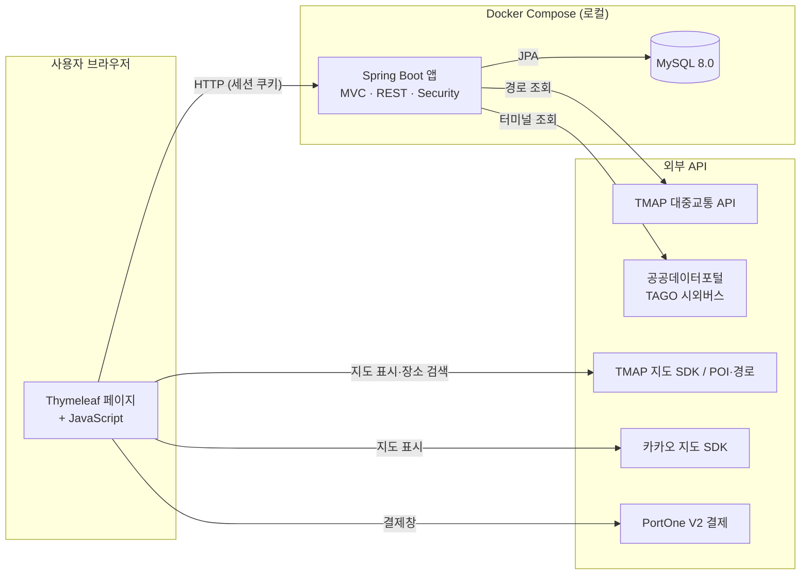
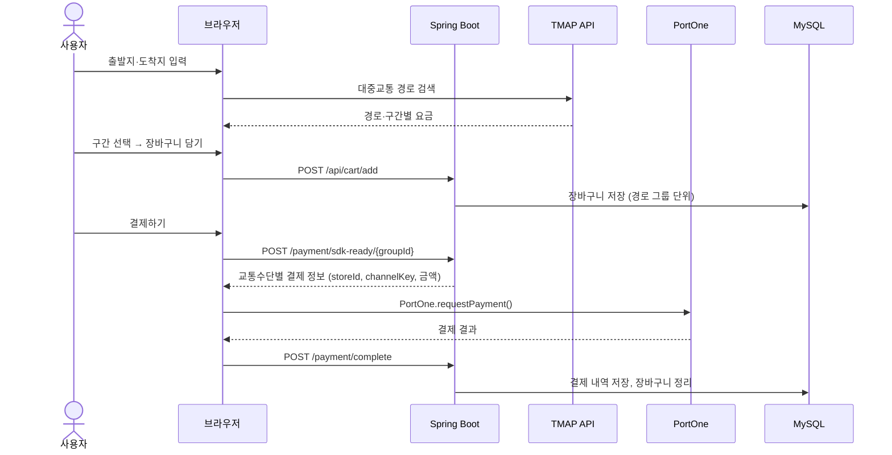

# MobilLax

**흩어진 대중교통 경로 검색·예매·결제를 하나의 웹에서 처리하는 통합 모빌리티 서비스**


> 2025-1학기 졸업 캡스톤디자인 3인 팀 프로젝트([원본 저장소](https://github.com/kimyeongbin-dev/MobilLax))를
> 팀 대표였던 본인이 **개인 프로젝트로 이어받아 개선**하고 있는 저장소입니다. → [버전 로드맵](#-버전-로드맵)

---

## 📌 목차
1. [프로젝트 개요](#-프로젝트-개요)
2. [주요 기능](#-주요-기능)
3. [아키텍처](#-아키텍처)
4. [기술 스택과 선정 이유](#-기술-스택과-선정-이유)
5. [로컬 실행 가이드](#-로컬-실행-가이드)
6. [프로젝트 구조](#-프로젝트-구조)
7. [버전 로드맵](#-버전-로드맵)
8. [AI 도구 활용](#-ai-도구-활용)
9. [팀 프로젝트 이력](#-팀-프로젝트-이력)
10. [회고](#-회고)

---

## 🧭 프로젝트 개요

### 해결하려는 문제
시내·시외버스, 지하철, 철도 같은 대중교통 수단은 **교통수단마다 다른 앱과 서비스로 나뉘어** 있습니다.
여러 수단을 갈아타는 장거리 이동이면 사용자는 경로 검색, 요금 확인, 예매, 결제를 앱마다 따로 반복해야 합니다.

### 접근 방법
- **경로:** 출발지와 도착지를 한 번 입력하면 TMAP 대중교통 API가 여러 수단을 엮은 경로와 구간별 요금을 돌려줍니다.
- **장바구니:** 사용자는 그중 필요한 구간만 골라 장바구니에 담습니다.
- **결제:** 담은 구간을 **교통수단별로 묶어 PortOne 결제창 한 번의 흐름으로** 결제합니다.
- **마이페이지:** 결제 내역과 최근 경로를 모아서 보여줍니다.

---

## ✨ 주요 기능

| 영역 | 기능 | 상태 |
|---|---|---|
| 회원 | 회원가입, 로그인·로그아웃 (세션, BCrypt 해싱) | ✅ |
| 경로 검색 | 출발지·도착지 장소 검색 (TMAP POI), 대중교통 다중 경로 조회 | ⚠️ 더미 데이터 |
| 경로 상세 | 구간별 교통수단·소요 시간·요금 표시, 지도 위 경로 시각화 | ⚠️ 더미 데이터 |
| 장바구니 | 원하는 구간만 선택해 담기, 경로 그룹 단위 조회·삭제 | ✅ |
| 결제 | 경로 상세에서 바로 결제, 장바구니 전체 결제 (교통수단별 분할, PortOne V2) | ✅ |
| 마이페이지 | 프로필 수정, 최근 이용 경로, 결제 내역, 회원 탈퇴 | ✅ |
| 시외버스 | 터미널 조회 API (공공데이터포털 TAGO) | ✅ API만 |
| 실시간 정보 | 경로 세부 내역의 실시간 반영 | ⏳ 미구현 |

> ⚠️ 경로 검색과 경로 상세는 화면과 흐름은 완성됐지만, 현재 실제 TMAP 응답 대신 **더미 데이터**를 씁니다. → [알려진 이슈](#알려진-이슈)

---

## 🏗 아키텍처

### 시스템 구성도



- 모든 키는 `.env` 한 곳에서 관리합니다. 브라우저가 쓰는 지도 SDK 키는 서버가 템플릿(`FrontendKeyAdvice`)과 `/module/config.js`(`FrontendConfigController`)로 내려줍니다.
- 브라우저가 TMAP REST API를 직접 호출하는 부분은 v2에서 서버 프록시로 옮길 예정입니다. → [알려진 이슈](#알려진-이슈)

### 예매·결제 흐름



### 데이터 모델
| 테이블 | 내용 |
|---|---|
| `users` | 회원 (이메일, 이름, BCrypt 비밀번호) |
| `cart_item_entity` | 장바구니 구간 (경로 그룹 ID, 교통수단, 출발·도착, 요금, 삭제 여부) |
| `payments` | 결제 내역 (결제 ID, 그룹 ID, 교통수단, 금액, 상태) |

---

## 🛠 기술 스택과 선정 이유

| 분류 | 기술 | 선정 이유 |
|---|---|---|
| 언어 | **Java 21** | 현재 LTS 버전. 장기 지원을 받으면서 record·패턴 매칭 같은 최신 문법을 쓸 수 있음 |
| 프레임워크 | **Spring Boot 3.2** | 회원·결제·외부 API 연동을 한 애플리케이션에서 다루기에 생태계(Security, JPA, WebClient)가 가장 넓고, 팀원 모두 익숙했음 |
| 인증 | **Spring Security** (세션 + BCrypt) | 서버 렌더링 구조에서는 JWT보다 세션 방식이 단순함. 폼 로그인, 비밀번호 해싱, 접근 제어를 직접 구현하지 않고 검증된 구현을 씀 |
| 뷰 | **Thymeleaf** | 별도 프론트엔드 서버 없이 하나의 앱으로 배포할 수 있음. Spring Security와 통합되어 로그인 상태에 따른 화면 분기가 쉬움 |
| 데이터 | **Spring Data JPA + MySQL 8.0** | 회원·장바구니·결제처럼 관계와 정합성이 중요한 데이터라 RDBMS를 씀. JPA로 반복 SQL을 줄임 |
| 외부 API 호출 | **WebClient / RestTemplate** | 공공데이터 API를 비동기(WebClient)로 호출. XML 응답은 Jackson XML로 매핑 |
| 경로 | **TMAP 대중교통 API** | 여러 교통수단을 엮은 경로와 **구간별 요금**을 함께 주는 공개 API여서 "통합 예매"라는 목표에 직접 맞음 |
| 지도 | **TMAP 지도 SDK, 카카오 지도 SDK** | TMAP은 경로 시각화와 POI 검색, 카카오는 홈 화면 지도 표시에 사용 |
| 결제 | **PortOne V2** | 여러 PG사를 하나의 SDK와 API로 연동할 수 있고, 계약 없이 **테스트 채널**로 전체 결제 흐름을 검증할 수 있음 |
| 공공데이터 | **공공데이터포털 TAGO** | 시외·고속버스 등 국토교통부 공식 데이터. 자동 승인이라 바로 연동할 수 있음 |
| 설정 | **spring-dotenv** | DB 접속 정보와 API 키를 코드에서 분리해 `.env` 하나로 관리 |
| 실행 환경 | **Docker Compose** | 개발자 PC의 JDK·MySQL 버전과 상관없이 **Java 21과 MySQL 8.0을 고정**함. 실제로 이 PC의 JDK 25에서는 Gradle 8.13이 돌지 않는 문제를 컨테이너 빌드로 해결함 |
| 협업 규칙 | **Git Hooks** (`.githooks`) | 커밋 컨벤션과 임시 커밋 차단을 사람의 주의력이 아니라 자동화로 지킴 |

---

## 🚀 로컬 실행 가이드

### 사전 요구사항
| 도구 | 버전 | 비고 |
|---|---|---|
| Docker Desktop | Docker Engine 24 이상, Compose v2 이상 | 앱(Java 21)과 MySQL 8.0이 모두 컨테이너에서 실행되므로 **로컬에 JDK나 MySQL이 필요 없음** |
| Git | 2.9 이상 | `core.hooksPath` 지원 |
| API 키 | TMAP, 카카오, PortOne (테스트), 공공데이터포털 | 발급 방법: [docs/ENV_SETUP.md](docs/ENV_SETUP.md) |

### 설치·실행

```bash
# 1. 클론
git clone https://github.com/kimyeongbin-dev/mobillax-v2.git
cd mobillax-v2

# 2. 초기 설정 — Git 훅 연결, .env 생성
./scripts/setup.sh          # Windows PowerShell: ./scripts/setup.ps1

# 3. .env 에 DB 비밀번호와 API 키 입력 (docs/ENV_SETUP.md 참고)

# 4. 빌드 + 실행
docker compose up -d --build
```

http://localhost:8080 에 접속합니다.

### 테스트

```bash
docker compose --profile test run --rm --build test
```

### 자주 쓰는 명령

| 목적 | 명령 |
|---|---|
| 로그 보기 | `docker compose logs -f app` |
| `.env`만 바꾼 뒤 재시작 | `docker compose up -d --force-recreate app` |
| 중지 | `docker compose down` |
| DB까지 초기화 | `docker compose down -v` (⚠️ 데이터 삭제) |

---

## 📁 프로젝트 구조

```
.
├── src/main/java/MobilLax
│   ├── Config/         # Security, WebClient, 외부 API 설정, 템플릿 키 주입
│   ├── Controller/     # 페이지·경로·터미널·회원·프론트 설정 컨트롤러
│   ├── Domain/
│   │   ├── Cart/       # 장바구니 (엔티티·리포지토리·서비스·API)
│   │   ├── MyPage/     # 마이페이지
│   │   └── Payment/    # PortOne 결제
│   ├── Model/          # 회원 엔티티, TMAP 응답 모델
│   ├── Repository/
│   └── Service/        # 경로·터미널·회원 서비스
├── src/main/resources
│   ├── templates/      # Thymeleaf 페이지
│   └── static/         # JS(경로·장바구니·결제), CSS, 지도 페이지
├── docs/ENV_SETUP.md   # .env 키 발급 가이드
├── .githooks/          # commit-msg, pre-push
├── scripts/            # setup.sh, setup.ps1
├── Dockerfile          # JDK 21 멀티 스테이지 빌드
└── docker-compose.yml  # app + MySQL (+ test)
```

개발 규칙(커밋 컨벤션, 브랜치, PR)은 [CONTRIBUTING.md](CONTRIBUTING.md)에 있습니다.

---

## 🗺 버전 로드맵

| 버전 | 목표 | 상태 |
|---|---|---|
| **v1** | 팀 프로젝트 최종 코드를 그대로 가져온 기준점 (하드코딩된 키만 분리) | ✅ 태그 `v1` |
| **v1.x** | 키 전면 재발급, 로컬 Docker에서 빌드·실행되는 상태 만들기 | 🔄 진행 중 |
| **v2** | 실제로 동작하는 서비스를 개선 (보안 수정, 코드 품질, 미구현 기능) | ⏳ |
| **v3** | 실제 배포 | ⏳ |

### 알려진 이슈

**기능**
- **경로 검색이 더미 데이터로 동작:** 홈(`script.js`)은 실제 TMAP 호출이 주석 처리되어 로컬 더미 JSON을 쓰고, 경로 상세(`route.js`)는 키가 자리표시자라 호출이 항상 실패한 뒤 외부 Postman mock 서버의 데이터를 씁니다. 외부 mock 서버는 팀원이 관리하는 것이라 언제든 사라질 수 있습니다.

**보안** — 원본 코드에서 물려받은 문제로, **v3 배포 전에 반드시 고칠 항목**입니다. v2에서 가장 먼저 다룹니다.

- **결제 검증 없음:** `/payment/complete`가 PortOne에 결제 결과를 확인하지 않고 클라이언트가 보낸 값으로 결제 완료를 기록합니다.
- **CSRF 보호 비활성화:** 세션 로그인 구조인데 CSRF 보호가 꺼져 있습니다.
- **TMAP REST 키 브라우저 노출:** 브라우저 JS가 REST API를 직접 호출하므로 서버 프록시로 옮겨야 합니다.
- **비로그인 장바구니:** `/api/**`가 전체 공개라 로그인하지 않은 사용자의 장바구니가 하나로 섞입니다.
- **내부 정보 노출:** 예외 메시지를 응답에 그대로 내보내고, SQL 바인딩 값까지 로그에 남깁니다.

---

## 🤖 AI 도구 활용

이 저장소는 **Claude Code를 페어 프로그래밍 도구로 활용**해 개발합니다.

- **맡긴 일:** 보일러플레이트와 반복 작업 — Docker·Compose 구성, 하드코딩된 키를 환경 변수로 옮기는 작업, Git 훅과 셋업 스크립트, 문서 초안, 히스토리·코드 전반의 비밀값 스캔과 보안 점검
- **직접 한 일:** 버전 로드맵과 범위 결정, 키 폐기·재발급, 저장소 공개 범위와 히스토리 정리 방침, 공통 개발 규칙 수립, 결과물 검토와 동작 확인
- **기록 방식:** 커밋에는 AI 트레일러(`Co-authored-by` 등)를 남기지 않고(`commit-msg` 훅으로 차단), 기여 내용은 이 섹션과 각 PR 본문에 밝힙니다.

---

## 👥 팀 프로젝트 이력

- **과제명:** 대중교통 통합 조회/예매 시스템 구축 (강원대학교 컴퓨터공학과 2025-1 캡스톤디자인)
- **원본:** [kimyeongbin-dev/MobilLax](https://github.com/kimyeongbin-dev/MobilLax) `map` 브랜치 최종본 (2025-06-09)

| 이름 | 역할 |
|---|---|
| **김영빈** (대표) | 기획·문서화 총괄, 대중교통 API 분석과 연동 구조 설계, 서버 구성, PortOne 결제 연동, MySQL 설계 |
| 육동주 | 백엔드 개발, TMAP 대중교통 API 연동과 데이터 처리, 테스트·품질 검수 |
| 김소현 | 프론트엔드 개발과 UI/UX 설계, 반응형 웹, 경로 시각화 |

이 저장소의 첫 커밋(태그 `v1`)이 위 팀 결과물이고, 이후 커밋은 개인 개선 작업입니다.

---

## 📝 회고

### v1.x — 다시 실행 가능한 상태로 만들기
- **"IDE에서는 됐는데" 문제:** `build.gradle`의 `mainClass`가 존재하지 않는 패키지를 가리키고 있었습니다. IDE에서 실행할 때는 드러나지 않는 문제라 팀 시절에는 발견되지 않았고, jar로 실행하자 바로 실패했습니다. → 빌드·실행을 컨테이너로 고정하는 이유가 됐습니다.
- **비밀값 관리:** `.gitignore`에 `.env`가 있었지만, 한때 커밋된 `.env`와 소스에 하드코딩된 키가 공개 저장소 히스토리에 남아 있었습니다. 또 `.gitignore`의 줄 끝 주석 때문에 예외 규칙이 동작하지 않기도 했습니다. → 모든 키를 폐기·재발급하고, 새 저장소는 깨끗한 히스토리로 시작했습니다.
- **규칙은 자동화로:** 커밋 컨벤션과 임시 커밋 차단을 Git 훅으로 강제해, 혼자 개발하더라도 협업 수준의 기록이 남도록 했습니다.
