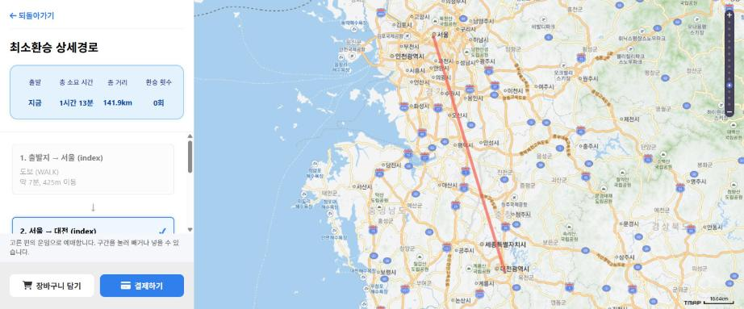

# v1.x 총평 (v1 → v1.8)

2025-1 캡스톤 팀 프로젝트의 최종 코드(`v1`)를 개인 저장소로 옮겨, **로컬에서 모든 기능이 실제로 동작하는 상태**로 만든 과정과 결과를 정리합니다.

- 기간: 2026-10-14 - 2026-10-16
- 범위: 태그 `v1`(원본 기준점) → `v1.8`, PR #1-#31
- 원칙: v1.x에서는 새 기능보다 **원본 기능을 실제로 동작하게 만드는 것**에 집중하고, 구조 개선과 큰 보안 수정(결제 검증, CSRF 등)은 v2로 넘깁니다. 실제 데이터로 동작시키는 데 꼭 필요한 기능과, 키 재발급·로그 마스킹처럼 바로 막아야 하는 보안 조치는 v1.x에서 했습니다.

---

## 1. 결론

**원본에 있던 사용자 기능은 로컬(Docker)에서 모두 동작합니다.** 원본에서는 더미 데이터로만 돌던 경로 검색과, 결제가 끝나도 기록되지 않던 결제까지 실제 데이터로 끝까지 동작합니다.

마지막 확인(2026-10-16, v1.8, 브라우저). 서버의 DB 읽기·쓰기는 아래 흐름에서 실제로 저장·조회되는 것으로 확인했습니다.

- **경로**: 카카오 장소 검색 → **실제 TMAP 경로 검색**(서울역 → 대전역) → 상세 지도·구간 → **TAGO 역 매칭과 실제 열차 편 선택**(130편). 콘솔 오류 없음
- **결제**: 장바구니 → **토스페이먼츠 테스트 결제(2,600원) 승인**(카드사 인증은 직접) → 결제 기록 저장 → 장바구니에서 제외 → 마이페이지 결제 내역(₩2,600)
  - 금액이 작은 편(서울 → 영등포 무궁화호)으로 시험하려고, TMAP을 호출하지 않고 열차 구간 하나짜리 경로를 화면에 넣어 진행했습니다(TMAP은 이 구간을 지하철로 안내). 역 매칭·편 조회·장바구니·결제는 실제 기능 그대로입니다
- **회원**: 일회용 계정으로 가입 → 로그인 → 프로필 수정 → 탈퇴, 로그아웃 안내

---

## 2. 기능별 동작 비교 (원본 v1 → v1.8, 로컬 기준)

| 기능                                          | 원본 v1                                                                                                     | v1.8                                             | 확인 방법                                                                                                                                                                                                  |
| --------------------------------------------- | ----------------------------------------------------------------------------------------------------------- | ------------------------------------------------ | ---------------------------------------------------------------------------------------------------------------------------------------------------------------------------------------------------------- |
| 회원가입·중복 확인                            | ✅ (가입 성공 안내 안 뜸)                                                                                   | ✅ 안내 표시, 깨진 이름 저장 차단                | 일회용 계정 가입·탈퇴                                                                                                                                                                                      |
| 로그인·잘못된 비밀번호                        | ✅                                                                                                          | ✅                                               | `/home`, `/login?error`                                                                                                                                                                                    |
| 로그아웃 안내                                 | ❌ JS 문법 오류로 안 뜸                                                                                     | ✅                                               | `/login?logout`                                                                                                                                                                                            |
| 카카오 장소 검색(홈)                          | ✅ (팀 시절 앱의 키를 써야 함)                                                                              | ✅ 새로 발급한 키, 무료 쿼터 이관                | "강남역" 자동완성                                                                                                                                                                                          |
| **대중교통 경로 검색**                        | ❌ **더미 JSON** (실제 호출이 주석 처리)                                                                    | ✅ 실제 TMAP (서버 프록시), 출발 일시 지정(14일) | 서울역 → 대전역 실제 검색                                                                                                                                                                                  |
| 경로 상세·지도                                | ⚠️ 외부 Postman mock 데이터, 요약이 항상 첫 경로 값                                                         | ✅ 실제 경로, 요약 버그 수정                     | 상세 화면                                                                                                                                                                                                  |
| 장거리 편 선택                                | 없음                                                                                                        | ✅ TAGO 실제 편·운임 (기차·고속·시외버스·항공)   | 서울 → 대전 130편                                                                                                                                                                                          |
| 장바구니 담기·조회·삭제                       | ⚠️ 더미 데이터의 구간 요금 기준                                                                             | ✅ 고른 편의 운임, 출발 시각이 지난 편 차단      | 담기·삭제·지난 편 자동 차단                                                                                                                                                                                |
| **결제**                                      | ❌ 결제창은 열리지만 **완료 기록이 저장되지 않음**(결제 번호 누락), 성공 후 오류 알림, 취소가 '실패'로 기록 | ✅ 테스트 결제 승인 → 기록 → 장바구니 정리       | 실제 테스트 결제 2,600원                                                                                                                                                                                   |
| 마이페이지                                    | ⚠️ 결제 내역이 늘 0원(기록 안 됨), 예매 예정 개수 과다, 없는 메뉴 클릭 시 500                               | ✅ 결제 내역·개수 정상, 없는 메뉴는 "준비 중"    | 결제 후 확인                                                                                                                                                                                               |
| 프로필 수정·회원 탈퇴                         | ✅                                                                                                          | ✅ (깨진 이름 거부)                              | 일회용 계정                                                                                                                                                                                                |
| 시외버스 터미널 조회 API                      | ❌ 공공데이터포털 옛 주소(`NO_OPENAPI_SERVICE_ERROR`, 서비스 이름 변경)                                     | ✅ 새 주소                                       | `/api/terminals?name=동서울`                                                                                                                                                                               |
| DB 상태 확인 (`/health/db`)                   | ⚠️                                                                                                          | ⚠️ 원본 그대로 (v2)                              | DB 연결을 하나 받아 JDBC `isValid(1)`만 확인 → "DB 연결 성공!". 실패해도 HTTP 200, 오류 시 예외 메시지 노출, 로그인 필요, 외부 API는 확인하지 않음. 실제 DB 동작은 로그인·장바구니·결제 기록 저장으로 확인 |
| 지도 실험 페이지 `map.html` (자동차 경로·POI) | ❌ 어떤 화면에서도 연결되지 않음, `publicRoute.js`를 불러오지 않아 초기화 오류, `config.js`가 저장소에 없음 | 삭제                                             | 쓰이지 않는 페이지로 판단해 삭제                                                                                                                                                                           |
| 홈 메뉴(예매확인·요금비교·주변정보)           | "준비 중" 알림                                                                                              | 그대로 (v2)                                      | —                                                                                                                                                                                                          |

> ✅ 동작 · ⚠️ 동작하지만 문제 있음 · ❌ 동작하지 않음

---

## 3. 원본에서 발견한 문제

### 동작 버그 (v1.x에서 수정)

| 문제                                                    | 원인                                                                                                    | 수정 버전 |
| ------------------------------------------------------- | ------------------------------------------------------------------------------------------------------- | --------- |
| 경로 검색이 더미 데이터                                 | `script.js`의 실제 호출이 주석 처리, `route.js`는 자리표시자 키로 항상 실패 후 팀원의 Postman mock 사용 | v1.2      |
| 결제 기록이 한 번도 저장되지 않음                       | `/payment/complete`가 `paymentId`를 빠뜨려 NOT NULL 제약 위반                                           | v1.8      |
| 결제 성공 후 "결제 처리 중 오류"                        | 없는 함수 `loadCart()` 호출                                                                             | v1.8      |
| 결제창을 닫으면 '실패'로 기록                           | PortOne V2 취소 코드(`PAY_PROCESS_CANCELED`)를 인식하지 못함                                            | v1.8      |
| 로그아웃·가입 안내 미표시                               | `alert([[${...}]])`가 따옴표 없이 출력되는 JS 문법 오류                                                 | v1.8      |
| 상세 요약이 다른 경로 값                                | `itineraries[0]`을 항상 사용                                                                            | v1.3      |
| 마이페이지 예매 예정 과다 집계, 결제한 묶음 재결제 준비 | 삭제·결제 표시(`isDeleted`)를 보지 않음                                                                 | v1.8      |
| 없는 메뉴·주소가 500                                    | 전역 예외 처리기가 모든 예외를 500으로 응답                                                             | v1.8      |
| 시외버스 API 호출 실패                                  | 공공데이터포털 서비스 주소 변경                                                                         | v1.1      |
| 페이지 콘솔 오류                                        | 장바구니·상세 화면이 서로의 스크립트를 실행                                                             | v1.8      |

### 보안·운영 문제

| 문제                                                       | v1.x 조치                                                                   | 남은 일                                |
| ---------------------------------------------------------- | --------------------------------------------------------------------------- | -------------------------------------- |
| 팀 저장소의 코드·히스토리에 API 키·DB 비밀번호가 남아 있음 | 히스토리 없이 새 저장소로 이전(`v1`에서 키를 `.env`로 분리), 키 전부 재발급 | 팀 저장소 비공개 전환 완료             |
| 서비스 키를 로그에 그대로 출력                             | 출력 제거, 로그 패턴에서 키 마스킹(테스트 포함)                             | —                                      |
| 브라우저가 TMAP REST를 키와 함께 직접 호출                 | 경로는 서버 프록시로, 직접 호출하던 지도 페이지 삭제                        | 지도 SDK용 키 분리·도메인 제한 (v3 전) |
| 결제 금액을 서버가 검증하지 않음                           | —                                                                           | v2                                     |
| CSRF 비활성화, 로그아웃이 GET                              | —                                                                           | v2                                     |
| `/api/**` 전체 공개로 비로그인 장바구니가 하나로 섞임      | — (테스트 중 실제로 재현)                                                   | v2                                     |
| SQL TRACE 로그, Docker root 실행                           | —                                                                           | v2                                     |

### 개발 환경 문제

- 로컬 JDK 25에서 Gradle 래퍼(8.13)가 동작하지 않음 → Docker(JDK 21)로 빌드·실행·테스트 통일
- 테스트가 컨텍스트 로드 1건뿐 → 단위·회귀 테스트 추가
- 커밋 규칙·훅·포맷 규칙 없음 → CONTRIBUTING, Git 훅, Prettier·ESLint 도입

---

## 4. 개선된 점

### 기능

- **실제 데이터로 동작하는 경로·편·결제 흐름**: TMAP 경로(뼈대) + 공공데이터포털 TAGO 편·운임(기차·고속버스·시외버스·항공) + PortOne 테스트 결제
- **TMAP 장소 ↔ TAGO 역·터미널 매칭**: 도로명·지번 주소 비교, 좌표 거리(1km) 보완, 같은 이름. 실측 16/17 일치 (나머지 1곳은 TAGO 목록에 없는 정류장)
- **예매 규칙**: 장거리 구간만 예매(시내 교통은 안내와 예상 운임), 당일 출발편만 예매, 조회는 14일, 출발 시각이 지난 편 차단, TAGO 편이 없는 구간(공항 리무진 등)은 현장 결제 안내
- **편 자동 선택**: 앞 구간 이동 시간 + 환승 여유(10·20·30분, 기본 20분)를 고려한 기본 편
- **운행 여부 반영**: 검색 시각에 운행하지 않는 구간 제외, 운행하는 경로를 우선 선택

### 품질·운영

- Docker Compose로 클론 후 명령 몇 줄로 실행·테스트
- 테스트: 로그 마스킹, 출발 일시 검증, 장소 매칭 규칙(10건), 예매 규칙·이름 검증
- Git 훅: 시크릿 검사, CRLF 차단, 커밋 메시지·AI 트레일러 검사, Prettier·ESLint (훅 회귀 테스트 42건)
- 외부 데이터 약관 준수: TMAP 데이터 24시간 저장 제한(매칭 캐시 자동 삭제), 카카오 좌표·검색 결과 비저장
- 예외별 HTTP 상태 코드, 5xx에서 내부 메시지 비노출
- 문서: README, ENV_SETUP(키 발급), PUBLIC_DATA_API(API·정책), CONTRIBUTING, 버전별 PR 기록

---

## 5. 바뀐 점 (원본과 다르게 동작하는 것)

| 구분           | 원본                                          | 지금                                                                                                                  |
| -------------- | --------------------------------------------- | --------------------------------------------------------------------------------------------------------------------- |
| 경로 API       | 브라우저가 TMAP 직접 호출                     | 서버 `POST /api/route/transit`                                                                                        |
| 결제 금액      | 경로의 구간 요금                              | 고른 TAGO 편의 운임                                                                                                   |
| 예매 대상      | 요금이 있는 모든 구간                         | 기차·고속버스·시외버스·항공, 당일 출발편                                                                              |
| 오류 응답      | `{"error", "message"(예외 원문)}`, 대부분 500 | `{"error": 안내 문구}`, 상태 코드 구분                                                                                |
| 삭제된 것      | —                                             | `map.html`·`module/*`, `/module/config.js`, `/route.html`, `GET /api/route/detail`, 쓰이지 않는 모델 14개·더미 데이터 |
| 새 API         | —                                             | `/api/place/match`, `/api/trips`                                                                                      |
| 새 테이블      | —                                             | `transit_place`(TAGO 기준표), `place_match`(24시간 캐시), 장바구니 `departure_time`                                   |
| 환경변수       | 팀 키                                         | 새로 발급한 키 + `KAKAO_APPKEY`(REST), `JUSO_SEARCH_KEY` (`TMAP_WEB_APPKEY`는 `TMAP_APPKEY`로 통합)                   |
| 실제 예매·발권 | —                                             | 운송사 제휴를 가정하고 PortOne 테스트 결제까지. 실제 서비스에서는 운송사 예매 시스템과 연동                           |

---

## 6. 버전별 이력

| 버전 | 내용                                                                      | PR             |
| ---- | ------------------------------------------------------------------------- | -------------- |
| v1   | 팀 프로젝트 최종 코드 기준점 (하드코딩 키만 분리)                         | —              |
| v1.1 | 키 전부 재발급, Docker 실행, 시외버스 API 주소, 로그 마스킹, 개발 규칙·훅 | #1, #2, #4-#10 |
| v1.2 | 경로 검색 실제 TMAP 연동, LF 통일                                         | #3, #11, #12   |
| v1.3 | 장거리 구간만 예매, 고속·시외버스 구분, 공공데이터 API 정리               | #13-#17        |
| v1.4 | 출발 일시 지정 경로 검색, 당일 예매 제한                                  | #18, #19       |
| v1.5 | TMAP 장소 ↔ TAGO 매칭, 운행 여부 반영, 조회 14일                          | #20-#22        |
| v1.6 | TAGO 편 선택, 고른 편 운임으로 결제                                       | #23, #24       |
| v1.7 | TMAP 약관(24시간) 준수, 현장 결제 안내, 환승 여유 선택, 열차 역 쌍 조회   | #25-#27        |
| v1.8 | 로컬 전체 점검 수정, 결제 완료 기록, 출발 시각 확인                       | #28-#31        |

---

## 7. 검증 방법

- 자동 테스트: `docker compose --profile test run --rm --build test`, `npm run test:hooks`, `npm run lint`, `npm run format:check`
- 브라우저 점검(Chrome): 위 2장의 기능을 하나씩 실행하고 콘솔 오류 확인
- 외부 API는 키를 출력하지 않고 결과(HTTP 상태·응답)로만 확인. TMAP은 하루 10건 제한이라 응답을 저장해 재사용하고 24시간 안에 삭제
- 실제 결제는 토스페이먼츠 테스트 모드(테스트 키는 승인이 가상으로 처리되어 금액이 차감되지 않음)로 카드사 인증까지 진행

---

## 8. v2로 넘기는 일

- **보안**: 결제 금액 서버 검증(PortOne 조회), 비로그인 장바구니 차단, CSRF·로그아웃 방식, 로그 수준, Docker 비루트 실행
- **헬스체크**: 실패 시 오류 상태 코드(503), 예외 메시지·내부 정보 비노출, 로그인 없이 컨테이너 헬스체크에서 쓸 수 있는 경로(단, 비로그인으로 DB를 조회하거나 데이터를 볼 수 없게 상태만 응답), DB 연결과 외부 API(TMAP·TAGO·카카오·도로명주소·PortOne) 상태를 모두 확인
- **장바구니 재설계**: 여러 경로 비교, 묶음 결제, 앞 편을 바꾸면 뒤 편 다시 고르기, 시내 교통비 표시 선택
- **미구현 기능**: 홈의 예매확인·요금비교·주변정보, 비밀번호 변경·알림 설정
- **정리**: 남은 ESLint 경고, 홈 카드의 TMAP 노선명 표기(실제 편은 TAGO 기준)
- 배포(v3) 전: TMAP 지도 SDK 키 분리·도메인 제한, 도로명주소 운영 키, SK open API 영리 이용 승인
